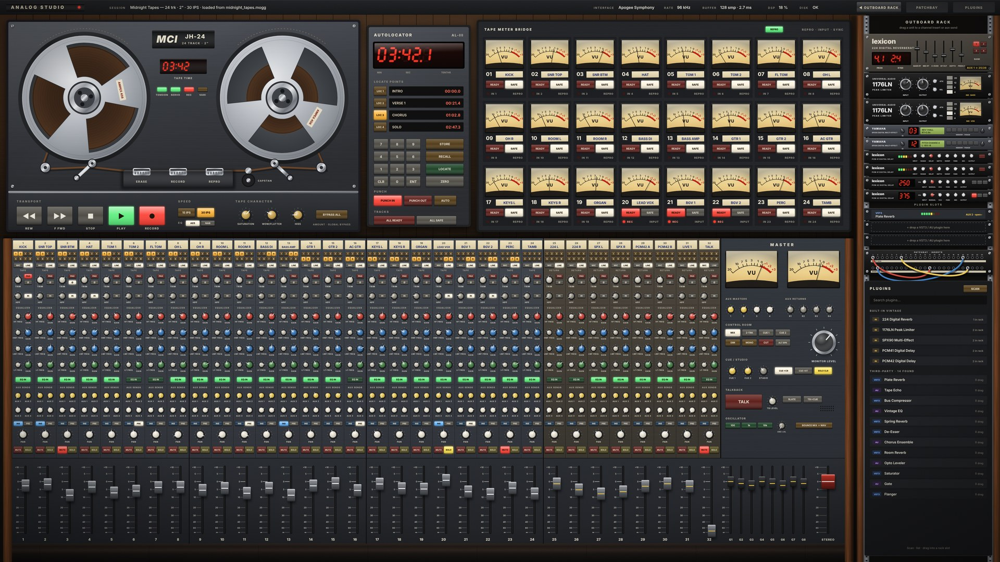

# Phase 0 – 4K UI mockup

A static, high-fidelity layout mockup at 3840×2160. It covers the tape machine, the 32-channel console and the outboard rack. No audio code exists yet. This is the approval gate set by the build prompt.



Full resolution: [`analog-studio-mockup-4k.png`](analog-studio-mockup-4k.png). A vector version you can zoom in a browser: `analog-studio-mockup.html`.

## What's on screen

| Area | Contents |
| --- | --- |
| Tape machine (top left) | JH-24-style 2" deck: flanged reels (supply full, take-up partly wound), tape path with guides, tension arms, erase/record/repro heads, capstan and pinch roller; tape-time display and status lamps; transport (REW, F FWD, STOP, PLAY, RECORD); 15/30 IPS and AES/NAB EQ; tape character (saturation, wow/flutter, hiss, global bypass) |
| Autolocator (top centre) | Lit counter, 4 named locate points, keypad, STORE/RECALL/LOCATE/ZERO, punch in/out/auto, all-ready/all-safe |
| Tape meter bridge (top right) | 24 backlit VU meters, each with a masking-tape track label, READY/SAFE switches and a REC/REPRO status line (tracks 20–22 armed) |
| Console (bottom) | 32 JH-600-style strips: scribble strip, 8 bus-assign buttons, mic/line, trim, pad, phase, HPF, 4-band EQ (freq + gain) with EQ IN, 4 aux sends, insert, pre, pan, mute, solo, long-throw fader. Channels 1–24 are tape returns; 25–32 (warm-tinted) are effect returns and live inputs |
| Master section | Stereo VU pair, aux masters and returns, control-room source/dim/mono/cut, monitor level, cue/studio, talkback, oscillator, bounce-to-WAV, 8 group faders, stereo master fader |
| Outboard rack (right side panel) | Lexicon 224, 2× UA 1176LN, 2× Yamaha SPX90, 2× Lexicon PCM41, 2× PCM42, three VST3/AU plugin slots, an insert patchbay with cables, and a plugin browser (scan, list, drag into a slot) |
| Top bar | Session name and source file, audio interface, sample rate, buffer and DSP load; tabs for the rack, patchbay and plugins |

## Known gaps (to be checked against your reference photos)

- Colours, knob caps and legends come from memory of the hardware, not from photos. Expect to correct them once you supply references.
- The front panels of the outboard units are simplified; their control layouts need to be checked against the real units.
- This view shows the rack as a side panel; it slides out over the console on smaller layouts.

## Rebuild

```sh
node mockup/src/build.js   # writes the SVG + HTML
node mockup/src/render.js  # renders the 4K PNG (uses the preinstalled Playwright/Chromium)
```
